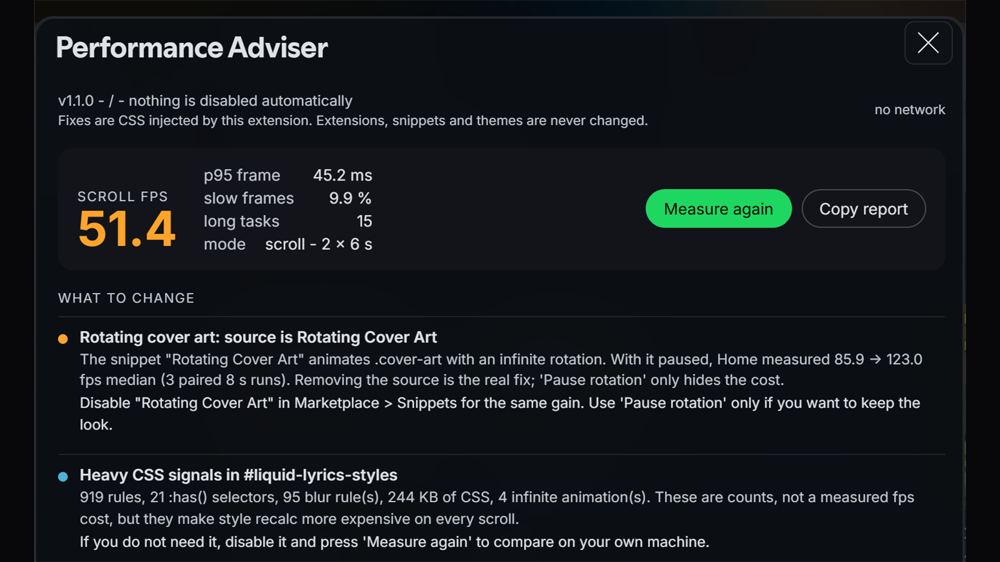

# Performance Adviser

A single-file Spicetify extension that measures your Spotify UI's scroll performance, finds the installed snippet, theme or extension responsible, and removes the cost with reversible CSS.



Performance Adviser does **not** rewrite Spotify's own JavaScript. It removes UI costs that themes, snippets, Spotify's hover behaviour and idle CSS rules add on top of it. Each fix is a separate toggle, so you can measure and undo every change.

## Features

- **Measured fixes, not guesses.** Every toggle has a before/after number from the same machine in the panel, and the panel can re-run the scroll test in your own client.
- **Two independent, recommended fixes**
  - disables the sticky-header backdrop blur (the single largest cost on blurred themes such as Lucid);
  - hides the Home card play button only while scrolling, which stops Spotify from repositioning its tooltip on every scroll frame.
- **Opt-in cover pause.** A decorative rotating `.cover-art` animation is usually added by a snippet you installed. The panel names that snippet (or theme) and tells you to disable it, because removing the source is the real fix. The **Pause rotation** toggle exists only for people who want to keep the effect, and it is never part of the recommended preset.
- **Runtime CSS patches.** Chromium treats every live `:has()` rule as a document-wide invalidation source, even one that currently matches nothing, so a single tooltip can force style recalculation across thousands of elements. The patch engine mirrors the two global `track-peek` anchors with a class, then parks other `:has()` rules that match nothing and restores each one the moment its target appears (context menu, dialog, search field). Rules that are in use are never touched.
- **Generic detection, no allow-list.** The scan reads every snippet, the theme and extension `<style>` blocks and counts what makes CSS expensive (`:has()`, blur, infinite animations, rule count), attributes infinite animations to the block that declares them, and turns the built-in profiler's measured per-script cost into findings. It does not need a name to be on a list — anything installed is measured.
- **Recommended preset.** One button enables the two CSS fixes that measured a clear win in this scenario plus the runtime CSS patches. Nothing cosmetic and nothing snippet-specific is included.
- **Built-in profiler.** Record a slow scroll and see callback time attributed by source (extension/script file), forced layout reads, long tasks, and long-animation-frame data. Wrappers exist only while recording and are restored on stop.
- **Live environment scan.** Shows Marketplace extensions and snippets, the active theme, active backdrop-filter surfaces, every CSS source ranked by cost signals, running infinite animations and which source declares them, page zoom, and leftover CSS.
- **One kill switch.** Removes every injected rule at once, keeping your chosen state for later.
- **No network access.** It injects reversible CSS, temporarily rewrites the selectors of already-loaded `:has()` rules, and reads the DOM. It never edits files, settings or installed extensions; parked rules are restored and the two track-peek anchors are mirrored with a class.

## Install

### Spicetify Marketplace (recommended)

1. Open **Marketplace → Extensions**.
2. Search for **Performance Adviser** and install it.
3. Restart Spotify when prompted.

### Manually

1. Download `perf-adviser.js` from this repository.
2. Copy it into your Spicetify extensions folder:
   - Windows: `%APPDATA%\spicetify\Extensions\`
   - Linux/macOS: `~/.config/spicetify/Extensions/`
3. Add it as the **first** entry of the extensions list and apply:

   ```sh
   spicetify config extensions perf-adviser.js
   spicetify apply -n
   ```

   Running `spicetify config extensions perf-adviser.js` puts it at the front if the list was empty; if you already have extensions, edit the `extensions` line so that `perf-adviser.js` comes first. Loading it early means its CSS is present before theme styles settle.
4. Restart Spotify.

## Usage

1. Click the gauge icon in the top bar.
2. Read the score card: median scroll FPS, p95 frame time, slow frames and long tasks. **Measure again** runs the test twice more; closing the panel during the test keeps the number honest.
3. **What to change** lists live evidence: an active header blur, a running animation with the snippet/theme that declares it, CSS blocks with heavy selector counts, or the biggest measured sources from your last profile. Nothing is recommended just because it is installed.
4. Use the toggles under **Fixes (measured)**. Each one applies or removes its CSS immediately and is stored in `localStorage`. **Runtime CSS patches** has its own section because it edits selectors in already-loaded stylesheets instead of injecting a new rule; it shows how many rules are parked, live and mirrored.
5. If you want a starting point, press **Apply recommended**.
6. For a specific slow page, press **Start recording**, scroll the page for about ten seconds, then **Stop recording**. The profile names the extension or script that owns the cost.

## Settings

| Setting | Default | What it does | Risk |
|---|---|---|---|
| Sticky header blur | On | Sets `--header-filters: none` and gives the five sticky header surfaces an opaque theme background. Removes the per-frame re-blur while content scrolls behind them. | The header loses its frosted look and becomes a solid band. Themes that intentionally use a translucent header will look different. |
| Home card play button | On | Adds a scroll class and hides `.main-card-PlayButtonContainer` **only while scrolling and only under `[data-testid="home-page"]`**, which stops the tooltip from being repositioned every frame. | The button disappears during a scroll and returns when you stop. Marketplace install/remove buttons use the same class and are **not** affected by this scoped rule. |
| Rotating cover art (opt-in) | Off | Pauses any running animation on `.cover-art` and the now-playing cover pseudo-elements, keeping the circular crop. The panel first names the snippet/theme that declares the animation; disabling that source is the better fix. | If a theme or snippet rotates the cover on purpose and you want to keep it, leave this off. Only turn it on when you cannot remove the source. |
| Theme tweaks | Off | Cosmetic bundle: Marketplace installed-card border, active-button colour, 72 px player bar. Not a performance fix. | Purely visual and theme-specific. Off by default and never part of the recommended preset. |
| Runtime CSS patches | On | Mirrors the two `track-peek` global `:has()` anchors with a class and parks other `:has()` rules that currently match nothing, restoring each one when its target appears. Part of the recommended preset. | Rules that are in use are never touched. A parked rule comes back in well under a second when its menu or dialog opens. If a specific dialog ever looks wrong, turn this off and report the selector. |
| Disable all fixes | — | Kill switch for every injected rule and every runtime patch. State is kept, so **Enable everything** restores your selection. | None. |

The panel remembers your choices in `localStorage["perf-adviser:state"]`.

## Measured results

Test conditions: Windows, Spotify **1.3.8.620** (Chromium 151), Spicetify **2.46.4**, 1922 × 1080 viewport, 8 s synthetic scroll on Home, pointer parked on a card play button with its tooltip mounted, three interleaved rounds in one session. Values are medians of the three rounds.

| Active fixes | Median FPS | p95 frame | Slow frames (>33 ms) | Tooltip style writes / 8 s | Long tasks / 8 s |
|---|---|---|---|---|---|
| None | 27.7 | 138.9 ms | 23.9 % | 1,331 | 47 |
| Header blur only | 29.2 | 138.9 ms | 21.8 % | 1,252 | 45 |
| Card button only | 66.2 | 20.9 ms | 3.4 % | 386 | 12 |
| Rotating cover only | 33.5 | 131.9 ms | 18.3 % | 1,345 | 45 |
| Header + card | 72.0 | 20.9 ms | 3.3 % | 387 | 13 |
| Header + card + cover pause (opt-in) | 104.8 | 14.0 ms | 2.1 % | 388 | 12 |

The **recommended preset** is the header + card row: **+44.3 fps (2.6×)** over no fixes, with no snippet-specific override. The cover pause is opt-in and added a further +32.8 fps in this scenario because the rotating-cover snippet was installed.

What the table means:

- The card-button fix is the largest single win in this scenario: it cuts tooltip style writes from ~1,331 to ~386 per 8 s and long tasks from 47 to 12.
- The cover pause adds most of its gain **after** the card fix (+32.8 fps on top of header + card), because the tooltip churn otherwise hides it. On its own it measured only +5.8 fps.
- The header fix is small on its own (+1.5 fps, within noise) but adds +5.8 fps on top of the card fix. It stays in the preset because it is low risk and fixes the visible ghosting of scrolling content through the header.
- The rotation in this test came from the **Rotating Cover Art** snippet, not from Spotify. Disabling that snippet removes the same cost without the override; the toggle is a fallback.

A separate paired test with the card fix already on measured **+37.1 fps** (median) when the rotating cover was paused.

Caveats, stated plainly:

- These are **rAF frame intervals during a synthetic `scrollTop` sweep**, not a real wheel scroll, and the display refreshes above 100 Hz, so absolute FPS can exceed 60. Compare rows, not the number itself.
- Home content is lazy-loaded and differs between sessions, which is why all conditions were interleaved on **one** page instead of reloading between them. Reload-based comparisons on this machine swung by more than 3× on identical CSS.
- One machine, one theme setup. Your numbers will differ; the panel measures yours.

### Top-bar hover and idle `:has()` rules

Hovering a top-bar icon mounts a tooltip. With every `:has()` rule live, that one hover forced Chromium to restyle the whole document several times. Three rounds on the installed build, runtime patch off vs on, same session:

| Runtime patch | Style recalc, one hover | Worst frame, card hover | Restyles >20 ms | 4 s top-bar icon sweep |
|---|---|---|---|---|
| Off | 118–160 ms (median 134) | 7 ms in 2 rounds, ~49 ms in 1 | 2 | 563–649 ms, 9–10 big |
| On | 83–93 ms (median 90) | 7.1–7.2 ms in all 3 | 0 | 367–421 ms, 0 big |

A hover on a **Made for you** card behaves the same way: p95 frame time was 7 ms in every round, but without the patch the worst frame hit ~49 ms in one of three rounds; with it, the worst frame stayed at 7 ms in all three. The patch leaves the 11 `:has()` rules that are genuinely in use untouched, including the empty-search-field rule.

The hover table is not a scroll measurement: style recalc and element counts come from a single tooltip hover, the 4 s sweep is a synthetic pointer sweep across four top-bar icons, and the worst-frame column comes from holding the pointer on one card. All are paired in the same session; the absolute element counts vary with how much of Home has loaded.

### Idle overhead

With the extension loaded but every fix off (kill switch on), versus a reload where the extension file was blocked at the network layer, 45 s idle windows, three alternating pairs:

| State | Script time / 45 s | Total task time / 45 s | Heap |
|---|---|---|---|
| Extension loaded, fixes off | 0.117 s | 40.7 s | 124.5 MB |
| Stock (extension blocked) | 0.015 s | 41.4 s | 124.9–200.7 MB |

The extension's own script time is around 2.5 ms per second of idle, and total task time is within reload-to-reload noise. With the kill switch on it registers no timers, observers or animation frames; only three passive scroll/wheel/touchmove listeners, and the profiler wrappers are installed only during a recording. The CSS/animation inventory is read when you open the panel or start a measurement, never on a timer.

With **Runtime CSS patches** on, it adds two `MutationObserver`s (body and head) and a short burst of scans while the page loads and stylesheets arrive. Those scans settle: in a measured session the engine ran 11–12 scans in the first ~10 seconds and none afterwards, and parked rules are only re-checked when a mutation could affect them.

## Compatibility

| Component | Tested |
|---|---|
| Spotify | 1.3.8.620 (Chromium 151), 1.3.7.2752 |
| Spicetify | 2.46.4 |
| OS | Windows 11 |
| Marketplace | Extensions tab, install and remove |

The fixes target Spotify class names and CSS variables (`--header-filters`, `.main-topBar-background`, `.main-home-filterChipsSection`, `[data-testid="home-page"]`, `.main-card-PlayButtonContainer`, `.cover-art`). Spotify UI updates can rename them; if that happens the panel's Environment section will report no active blur or no rotating cover, and the matching fix simply does nothing.

The runtime patch has no class-name list of its own: it reads every loaded stylesheet, matches `:has()` rules against the live DOM, and restores each parked rule when its own target reappears. A Spotify update that renames classes therefore does not break it — at worst a rule is parked while its target is absent, which is exactly when it would have matched nothing anyway.

## Known limitations

- **It cannot speed up Spotify's own JavaScript.** Tracklist re-renders, network work and Spotify's React tree are outside its reach. Large playlist gains require disabling heavy third-party extensions; record a profile there and the panel will name the biggest source so you can test disabling it yourself. The extension never does that for you.
- The header fix only helps when something applies `backdrop-filter` to the sticky header — usually a theme. On a stock-looking client it is inert.
- CSS counts (`:has()`, blur, rule count) are **signals**, not measured fps. They say where style recalculation is likely to be expensive; only the profiler gives measured per-source time. Record a profile on the slow page before disabling something you like.
- The cover pause is opt-in. The rotation is almost always added by a snippet or theme you installed, so the panel names that source and recommends removing it; only use the toggle if you want to keep the look.
- **Runtime patches are CSS-only.** They cannot make Spotify's JavaScript faster. They also only park `:has()` rules that currently match nothing; a rule in active use (for example the empty search field) stays live because removing it would change the UI.
- The runtime patch relies on how Chromium 151 invalidates style for `:has()`. If a future Chromium makes the cost disappear, the patch becomes unnecessary rather than harmful.
- "Slow" is relative: a synthetic scroll is harsher than a real wheel scroll, so use the ranking and the toggles to test on your own machine.
- The tooltip fix is Home-specific by design; applying it globally would hide Marketplace install/remove buttons, which reuse the same container class.

## Troubleshooting

| Symptom | Check |
|---|---|
| No gauge button in the top bar | Is `perf-adviser.js` listed in `extensions`? Run `spicetify apply -n` and restart Spotify. |
| Panel opens but a fix does nothing | Check the Environment section: no blur or no rotation means there is nothing to remove on that page/theme. |
| Header is still blurred | Another extension or the theme may re-apply `backdrop-filter` with higher specificity. The Environment section counts active surfaces; report the case with a **Copy report**. |
| FPS looks low right after opening | Home lazy-loads shelves. Let the page settle, keep the pointer off the card grid for a stable baseline, and use **Measure again**. |
| Cover is frozen and you want it back | Turn off **Rotating cover art (opt-in)**. |
| A menu or dialog looks wrong after enabling patches | Turn off **Park idle :has() rules**. Parked rules are restored when their target appears, so please report the dialog and include the **Copy report** JSON. |
| A snippet rotates the cover and you want the fps back | Disable that snippet in **Marketplace > Snippets** — the panel names it under **What to change**. |
| Not sure what to disable | Open **Installed CSS (signals)**, then record a profile on the slow page. The biggest measured source appears under **What to change** automatically. |
| Something else looks wrong | Use **Disable all fixes**, then report the issue with the **Copy report** JSON and your Spotify/Spicetify versions. |

Uninstall in one line:

```sh
spicetify config extensions perf-adviser.js- && spicetify apply -n
```

Then delete `perf-adviser.js` from your Spicetify extensions folder if you wish.

## Contributing

Issues and pull requests are welcome. A useful bug report includes:

- Spotify and Spicetify versions;
- whether each of the two recommended fixes was on, and whether the opt-in cover pause was on;
- the **Copy report** JSON from the panel;
- what page was being scrolled and where the pointer was.

The extension must stay self-contained: one `.js` file, no build step, no remote code, no network requests.

## License

[MIT](LICENSE)
